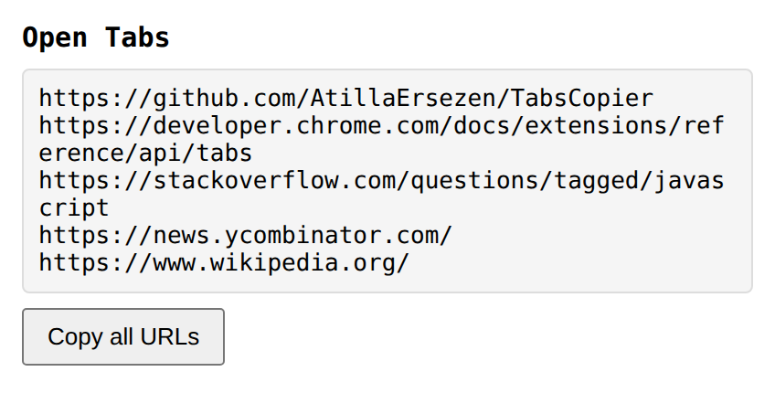

# Tabs Copier

A small browser extension that lists the URLs of all your open tabs and copies them to the clipboard in one click.

## Why

Browser sync between devices doesn't always work: you're on a different browser, signed out, or sync is just stuck. This extension is a practical fallback so you can keep working anyway. Copy your open tabs, send them to yourself however you like (email, WhatsApp, a note), and open them on the other device.

Tabs Copier does not send anything itself. There's no email or WhatsApp integration, and nothing leaves your browser. It only copies the URLs to your clipboard, and you paste them wherever you want.

## How it works

1. Click the extension icon. The popup lists every open tab's URL, one per line.
2. Click **Copy all URLs**.
3. Paste the list into an email, chat, or anything else, and open the links on your other device.

## Install

1. Clone or download this repository.
2. Open `chrome://extensions` (or `brave://extensions`, `edge://extensions`).
3. Turn on **Developer mode**.
4. Click **Load unpacked** and select the project folder.

The only permission it needs is `tabs`, which lets it read the URLs of your open tabs.
